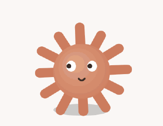
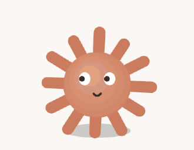
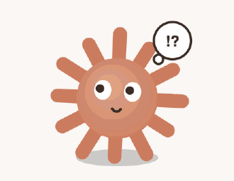
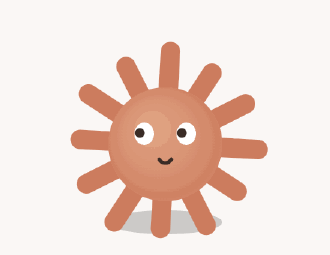
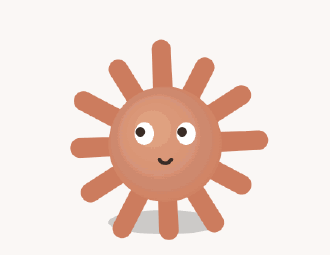
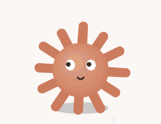
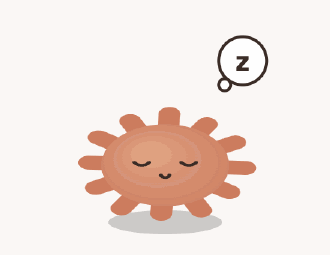
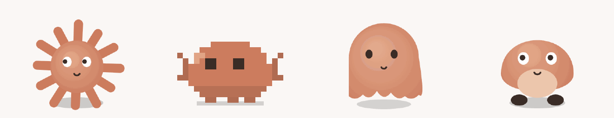

<div align="center">

# claude-pet

**A tiny desktop companion that lives on your screen and reacts to your [Claude Code](https://code.claude.com) sessions.**

Stop alt-tabbing to check on the agent. One glance tells you whether it's
**working**, **waiting on you**, **done**, or **stuck**.



</div>

- 🫧 **Always in view.** Floats above every window, on every Space and over full-screen apps, and never steals focus or clicks.
- 🔔 **Gets your attention.** Bounces, shakes and (optionally) chimes when Claude needs a permission or your reply, and gets more insistent the longer you ignore him.
- 🧭 **Watches every session.** Tracks all your Claude Code sessions at once, shows the most urgent one, and lists them all when you hover.
- 🔒 **Look, don't touch.** The pet only listens to Claude Code's hooks on `127.0.0.1`. It can't approve, block or change anything in a session.
- 🪶 **Featherweight.** No accounts, no cloud, no telemetry, and not a single image or sound file: everything is drawn and synthesized in code.

## What he does

<table>
  <tr>
    <td align="center" width="50%">
      <br>
      <b>Working</b><br>
      <sub>Munches code tokens. His paws match the tool: taps for Bash, hammers for Edit, peers for Read and Grep.</sub>
    </td>
    <td align="center" width="50%">
      <br>
      <b>Needs you</b><br>
      <sub>Bounces with a <code>?</code> when Claude asks for permission or it's your turn.</sub>
    </td>
  </tr>
  <tr>
    <td align="center">
      <br>
      <b>…and won't let you forget</b><br>
      <sub>Ignore him for a minute and he gets louder. After three, it's frantic shaking and <code>!?</code>.</sub>
    </td>
    <td align="center">
      <br>
      <b>Done</b><br>
      <sub>A jump, a <code>✓</code> and confetti when the turn finishes.</sub>
    </td>
  </tr>
  <tr>
    <td align="center">
      <br>
      <b>Something broke</b><br>
      <sub>Turns red and droops when a tool or turn fails. A run of failures brings out the sweat.</sub>
    </td>
    <td align="center">
      <br>
      <b>Subagents</b><br>
      <sub>One little moon orbits him for every running subagent.</sub>
    </td>
  </tr>
  <tr>
    <td align="center">
      <br>
      <b>Compacting context</b><br>
      <sub>Spiral eyes and a woozy sway while the conversation is squeezed down.</sub>
    </td>
    <td align="center">
      <br>
      <b>Napping</b><br>
      <sub>Nods off after 15 quiet minutes and wakes the moment Claude does.</sub>
    </td>
  </tr>
</table>

<div align="center">
  <br>
  <b>Pick a form, or bring the whole flock</b><br>
  <sub>Four forms (claude, clawd, blob, ghost) and up to four pets at once, all mirroring the same sessions.</sub>
</div>

### And a few more tricks

- **Hold the cursor on him** while he's idle and he'll close his eyes and send out hearts. **Click** to poke him.
- **Drag** him anywhere. He remembers where you left him, and his eyes follow your cursor.
- **Adventure mode** sends him on walks along the bottom of the screen, climbing up a corner, crawling upside-down along the top and dropping off the far side.
- **Right-click** him (or the menu-bar icon) for form, size (1×, 1.5×, 2×), number of pets, wandering, chime volume and more.

## Install

You need macOS, [Node.js](https://nodejs.org) 22.18 or newer, and Claude Code.

```bash
git clone https://github.com/miha53cevic/claude-pet.git
cd claude-pet
npm install
npm start
```

The pet appears in the bottom-right corner of your screen. Now connect it to Claude Code:

**Right-click the pet → Claude Code hooks → Install / update hooks…**

That's it. Every Claude Code session you start from now on reports to the pet.
(Sessions that were already open keep running without it until you restart them.)

<details>
<summary>Prefer the terminal?</summary>

```bash
npm run install-hooks -- --dry-run   # preview the change to ~/.claude/settings.json
npm run install-hooks                # back up settings.json, then add the hooks
```

</details>

<details>
<summary>Make it a real app (and start it at login)</summary>

```bash
npm run package
cp -r dist/claude-pet-darwin-arm64/claude-pet.app /Applications/
```

Open **claude-pet** from Applications, then right-click the pet → **Start at login**.
The app isn't signed, so on a Mac other than the one that built it, right-click
it and choose **Open** the first time.

</details>

## Uninstall

1. Right-click the pet → **Claude Code hooks → Uninstall hooks…**
   (or run `npm run uninstall-hooks` in the repo).
2. Quit the pet, then delete the repo folder and `/Applications/claude-pet.app`
   if you copied it there.
3. Optional: remove its saved settings with
   `rm -rf ~/Library/Application\ Support/claude-pet`.

Install and uninstall both leave a timestamped backup next to
`~/.claude/settings.json` and only ever touch the pet's own hook entries.

## Learn more

Curious how it works, want to add your own pet form, or something isn't
working? See **[TECHNICAL.md](TECHNICAL.md)**.

## License

[MIT](LICENSE)
